# PI_IV-Time-11 — Fast Attendance

Repositório do Projeto Integrador do quarto semestre, PUC Campinas 2026.

O **Fast Attendance** é um sistema de chamada com prova de proximidade para professores do
ensino superior. A cada aula, o professor escolhe um de três modos de confirmação de presença:

1. **Chamada clássica**: marcação manual por lista, com marcação em lote.
2. **QR Code rotativo**: token TOTP (RFC 6238) exibido em QR Code e renovado a cada poucos segundos.
   O aluno confirma a presença dentro do raio da sala.
3. **Onda sonora**: o mesmo token, transmitido em faixa ultrassônica (18–20 kHz).

Os modos 2 e 3 usam a mesma lógica de segurança; muda só o canal que entrega o token ao aluno.

## Estado atual

Este quadro deve ser atualizado a cada marco. Ele descreve o que está no `develop`.

| Parte | Situação |
|---|---|
| **API REST** (`api/`) | Pronta: cadastro e login com JWT, perfil, turmas, matrículas, salas, frequência, estatísticas, histórico do aluno e sessões ativas. Detalhes em [docs/api-rest.md](docs/api-rest.md). |
| **Servidor de sessão** (`sessao/`) e **ponte** (`ponte/`) | Prontos, no modelo cliente-servidor por sockets, com a ponte para os apps web: abrir e encerrar sessão, chamada clássica, check-in pelo canal QR Code e validação do canal sonoro, acompanhamento em tempo real. |
| **Antifraude** (no servidor) | Pronto: token válido, matrícula e unicidade por aluno/aparelho nos canais QR Code e Som; raio até a sala (Haversine) somente no QR Code. Check-ins enviados pela ponte WebSocket/TCP. |
| **Painel ao vivo** | Pronto: o professor vê as presenças chegarem por Change Streams do MongoDB. |
| **App do professor** | Turmas, matrículas, salas, chamada clássica, chamada por QR Code rotativo e painel ao vivo. A tela de emissão por Som está no PR #125. |
| **App do aluno** | Login, início (turmas, frequência, chamadas abertas), histórico, QR Code com geolocalização e captação por som com confirmação automática. |
| **Modo Som ponta a ponta** | Captação e check-in integrados no aluno. A emissão na tela do professor está no PR #125 (dependente do #118). Fluxo digital conferido com as duas telas, ponte e banco reais; medições acústicas em sala continuam pendentes. Ver [docs/checkin-som.md](docs/checkin-som.md). |

## Arquitetura



[Arquitetura e fluxo de check-in](docs/arquitetura.md) ·
[Fonte editável](docs/diagramas/arquitetura.mmd) ·
[PNG para apresentações](docs/diagramas/arquitetura.png)

O servidor de sessão segue o modelo cliente-servidor por sockets (TCP, serialização Java, classes
`Servidor`, `AceitadoraDeConexao`, `SupervisoraDeConexao`, `Parceiro` e `Comunicado`). Como o
navegador só fala WebSocket, a **ponte** converte o JSON do protocolo v1 em `Comunicado`s e vice-versa; os
apps não mudam. Veja [docs/servidor-modelo-socket.md](docs/servidor-modelo-socket.md).

A API e o servidor de sessão compartilham o MongoDB e o segredo `JWT_SECRET`: o servidor de sessão
valida o mesmo JWT que a API emite, na mensagem `auth` (recebida pela ponte, no WebSocket). As regras de unicidade
(uma presença por aluno e por sessão, uma sessão aberta por turma) ficam em índices do banco, porque
as duas aplicações escrevem nas mesmas coleções. O [fluxo de check-in por QR Code e som](docs/arquitetura.md#fluxo-do-check-in)
mostra a validação, a persistência e a atualização do painel, com as partes ainda pendentes nos apps.

## Estrutura do repositório

| Caminho | Conteúdo |
|---|---|
| `common/` | Modelos, protocolo de mensagens, `Comunicado`s e JWT compartilhados (Java 21) |
| `api/` | Servidor HTTP: Spring Boot e MongoDB |
| `sessao/` | Servidor de sessão em tempo real, no modelo cliente-servidor por sockets (TCP) |
| `ponte/` | Ponte WebSocket (protocolo v1, JSON) ↔ servidor de sessão (TCP), com Java-WebSocket |
| `apps/professor/` | Aplicação web do professor (Next.js 16, React 19) |
| `apps/aluno/` | Aplicação web do aluno (Next.js 16, React 19) |
| `infra/` | Docker Compose, Nginx, script de replica set e contas de demonstração |
| `audio/` | Módulo de emissão do token sonoro, com testes em Node |
| `spikes/` | Experimentos técnicos (áudio ultrassônico) |
| `docs/` | Protocolo, API, modelo de dados, stack e wireframes |

## Como rodar

### Pré-requisitos

- Docker com Compose v2 (no macOS e no Windows, o Docker Desktop aberto).
- JDK 21 (somente para compilar ou rodar a API ou o servidor de sessão fora do Docker, e para os testes).
- Node.js 24 ou superior (somente para rodar os apps em modo de desenvolvimento).
- `curl`, para o script de contas de demonstração.

### Subir o ambiente

Em uma máquina de teste, clone a branch `develop` e entre no repositório:

```bash
git clone --branch develop --single-branch https://github.com/Leonunciaroni/PI_IV-Time-11.git
cd PI_IV-Time-11
```

No Windows, deixe o Docker Desktop iniciado antes de continuar.

```bash
cd infra
cp .env.example .env          # edite JWT_SECRET (mínimo de 32 bytes)
docker compose up -d --build
docker compose ps             # aguarde os serviços ficarem "healthy"
```

Gere um segredo com `openssl rand -base64 48` e cole o valor em `JWT_SECRET`. Preencha também
`MONGO_KEYFILE`, `MONGO_ROOT_SENHA` e `MONGO_APP_SENHA`, cada um com `openssl rand -hex 24`: o
MongoDB roda com autenticação ([infra/README.md](infra/README.md#autenticação)). O Compose não sobe
sem essas variáveis.

Variáveis principais do `infra/.env`:

| Variável | Padrão | Uso |
|---|---|---|
| `JWT_SECRET` | (obrigatória) | Assinatura dos JWTs da API e do servidor de sessão |
| `MONGO_KEYFILE` | (obrigatória) | Keyfile com que os três nós do replica set se autenticam entre si |
| `MONGO_ROOT_USUARIO` / `MONGO_ROOT_SENHA` | `root` / (obrigatória) | Administrador do MongoDB, usado só para iniciar o replica set |
| `MONGO_APP_USUARIO` / `MONGO_APP_SENHA` | `fast_attendance` / (obrigatória) | Usuário da API e do servidor de sessão, com `readWrite` só em `fast_attendance` |
| `JWT_EXPIRACAO_HORAS` | `12` | Validade do token |
| `PROFESSORES_PERMITIDOS` | `professor@demo.br` | E-mails ou domínios (`@dominio.edu.br`) que podem criar conta de professor |
| `NGINX_PORTA` | `8088` | Porta publicada no host; se mudar, troque também os endereços abaixo |
| `SESSAO_DURACAO_MAXIMA_MIN` | `240` | Sessões abertas por mais que isso são encerradas automaticamente |

### Contas de demonstração

Com o ambiente no ar, crie um professor e dois alunos (senha `demo12345`, só para ambiente local):

```bash
./infra/usuarios-demo.sh            # a partir da raiz do repositório
```

O script é idempotente. Ele cria `professor@demo.br` (professor), `ana@demo.br` e `bruno@demo.br`
(alunos). Se o e-mail do professor não estiver em `PROFESSORES_PERMITIDOS`, o script falha com
essa mensagem.

Para a apresentação, `./infra/dados-demo.sh` cria também 60 alunos, duas turmas com mais de 30
alunos cada, salas e aulas passadas com presenças nos três modos, para o dashboard ter dados. Detalhes
em [infra/README.md](infra/README.md#dados-de-demonstração-dashboard-e-apresentação).

### Endereços

| Endereço | O que é |
|---|---|
| http://localhost:8088/professor | Aplicação do professor |
| http://localhost:8088/aluno | Aplicação do aluno (`/` redireciona para cá) |
| http://localhost:8088/api | API REST ([docs/api-rest.md](docs/api-rest.md)) |
| ws://localhost:8088/ws | Ponte para o servidor de sessão ([docs/protocolo-v1.md](docs/protocolo-v1.md)) |

Apenas o Nginx é publicado no host, além do `mongo1` em `127.0.0.1:27017`, para ferramentas
locais. Para conectar ao MongoDB de fora do Docker, use o usuário da aplicação:
`mongodb://<MONGO_APP_USUARIO>:<MONGO_APP_SENHA>@localhost:27017/fast_attendance?directConnection=true`.

### Desenvolvimento dos apps com recarga automática

Deixe o Compose rodando (ele fornece a API, o servidor de sessão e o MongoDB) e rode o app em outro
terminal:

```bash
cd apps/professor && npm install && npm run dev    # http://localhost:3000/professor
cd apps/aluno && npm install && npm run dev        # http://localhost:3001/aluno
```

Em modo de desenvolvimento, `/api` e `/ws` são encaminhados para o Nginx em `localhost:8088`
(variável `API_URL`, se precisar mudar).

### Rodar a API ou o servidor de sessão fora do Docker

Veja [infra/README.md](infra/README.md), seção "Rodar a API ou o servidor de sessão fora do Docker".
Resumo: pare o serviço no Compose (`docker compose stop api`), compile com
`./mvnw -pl api -am package -DskipTests` e rode com `JWT_SECRET=<mesmo valor do .env>`.

### Parar o ambiente

```bash
cd infra
docker compose down        # mantém os dados
docker compose down -v     # apaga também os volumes do MongoDB
```

## Testes

```bash
./mvnw verify                              # common, api e sessao; os testes da API sobem MongoDB em contêiner
cd apps/professor && npm test              # testes unitários do app do professor (Vitest)
cd apps/aluno && npm test                  # leitura QR, localização e transporte de check-in (Vitest)
node --test audio/emissor.test.mjs         # testes do emissor sonoro (Node)
```

Os testes da API usam Testcontainers, então o Docker precisa estar rodando. Para lint e build dos
apps, veja [CONTRIBUTING.md](CONTRIBUTING.md).

## Privacidade e LGPD

Esta seção descreve o que o código faz hoje. Ela segue [docs/modelo-de-dados.md](docs/modelo-de-dados.md).

**Dados pessoais guardados.** Nome, e-mail, matrícula (RA ou registro do professor), hash BCrypt da
senha e os registros de presença de cada aluno. A senha em texto nunca é persistida.

**Coordenadas.** São gravadas somente nas presenças do modo QR Code, e só servem para auditar a
validação de raio. No canal sonoro, as coordenadas enviadas pelo app são ignoradas: não são
validadas nem gravadas. As salas guardam as coordenadas do local, que não são dados pessoais.

**`dispositivoId`.** É um UUID aleatório gerado pelo app do aluno na primeira execução e guardado no
navegador (`localStorage`). Ele é enviado no check-in e gravado na presença do modo QR Code ou sonoro.
Serve para impedir que um mesmo aparelho registre presença para dois alunos na mesma sessão. Não
identifica o aparelho fora do sistema. A marcação manual não grava `dispositivoId`.

**Token de acesso (JWT).** Assinado com HS256 e válido por 12 horas por padrão. O payload contém o
id, o nome e o papel do usuário. O token é assinado, não cifrado: não deve ser exibido nem registrado
em logs. Ele não vai na URL do WebSocket; é enviado na mensagem `auth`.

**Limitações conhecidas (ambiente de desenvolvimento).** O MongoDB do Compose roda sem autenticação e
só é acessível pela rede interna e pelo loopback do host. As contas de demonstração usam senha
conhecida e não devem existir em produção. Não há política de retenção nem rotina de exclusão de
dados implementadas; a exclusão de uma conta ou de presenças ainda não tem endpoint.

## Documentação

Somente documentos que existem no repositório:

| Documento | Conteúdo |
|---|---|
| [docs/protocolo-v1.md](docs/protocolo-v1.md) | Protocolo WebSocket entre os apps e o servidor de sessão, pela ponte (revisado em 04/11/2026) |
| [docs/testes-validacao.md](docs/testes-validacao.md) | Testes JUnit das regras e relatório de cobertura |
| [docs/servidor-modelo-socket.md](docs/servidor-modelo-socket.md) | Servidor de sessão no modelo por sockets e a ponte WebSocket↔TCP |
| [docs/perfil.md](docs/perfil.md) | Edição de perfil e troca de senha nos dois apps |
| [docs/api-rest.md](docs/api-rest.md) | Endpoints REST |
| [docs/modelo-de-dados.md](docs/modelo-de-dados.md) | Coleções, índices do MongoDB e observações de LGPD |
| [docs/arquitetura.md](docs/arquitetura.md) | Diagramas de arquitetura e check-in, imagens para slides e fontes editáveis |
| [docs/stack-apps.md](docs/stack-apps.md) | Decisões de stack das aplicações web |
| [docs/cadastro.md](docs/cadastro.md) | Cadastro docente e regras de autorização |
| [docs/plano-teste-carga.md](docs/plano-teste-carga.md) | Cenário JMeter para 15 salas × 70 alunos e critérios de aprovação |
| [docs/https-celulares.md](docs/https-celulares.md) | HTTPS e diagnóstico de permissões nos celulares |
| [docs/wireframes.md](docs/wireframes.md) | Telas do professor e do aluno |
| [docs/roteiro-demonstracao.md](docs/roteiro-demonstracao.md) | Roteiro cronometrado, preparação e plano B da demonstração |
| [docs/inicio-aluno.md](docs/inicio-aluno.md) | Tela inicial do aluno, frequência e chamadas abertas |
| [docs/checkin-qr.md](docs/checkin-qr.md) | Leitura do QR Code e check-in com geolocalização |
| [docs/checkin-som.md](docs/checkin-som.md) | Captação do token pelo microfone e check-in por som |
| [docs/revisao-aluno.md](docs/revisao-aluno.md) | Revisão dos wireframes e regressão das telas do aluno |
| [docs/historico-aluno.md](docs/historico-aluno.md) | Histórico de frequência do aluno por turma |
| [docs/audio-modem.md](docs/audio-modem.md) | Emissão do token sonoro |
| [docs/spikes/audio-ultrassom.md](docs/spikes/audio-ultrassom.md) | Spike do canal sonoro 18–20 kHz |
| [docs/entrega/relatorio-tecnico.md](docs/entrega/relatorio-tecnico.md) | Relatório técnico do sistema e resultados verificados |
| [docs/entrega/apresentacao-final.pdf](docs/entrega/apresentacao-final.pdf) | Apresentação do projeto em PDF; fonte HTML ao lado |
| [docs/entrega/checklist.md](docs/entrega/checklist.md) | Checklist de entrega e evidências da issue #75 |
| [infra/README.md](infra/README.md) | Ambiente Docker, MongoDB, rotas do Nginx e tolerância a falha |
| [CONTRIBUTING.md](CONTRIBUTING.md) | Branches, commits e pull requests |

## Fluxo de trabalho

Veja [CONTRIBUTING.md](CONTRIBUTING.md) para o modelo de branches, a convenção de commits e como
abrir pull requests.
