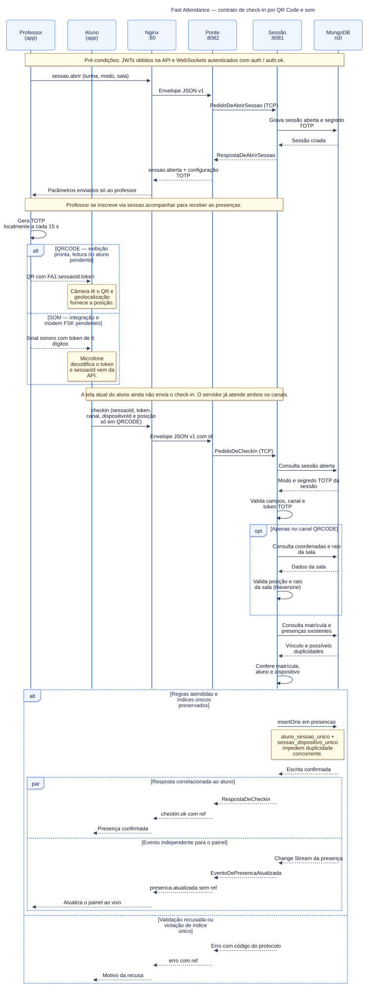

<!-- Autoria: Diogo Gonçalves Tonhosolo | RA: 25894007
Arquivos relacionados com o mesmo crédito: diagramas/arquitetura.png, diagramas/fluxo-checkin.png, diagramas/mermaid.config.json -->
# Arquitetura do Fast Attendance

Diagramas da issue #73, conferidos com a `develop` no commit `032a510`
(ponte WebSocket↔TCP, PR #109), em 12/11/2026. A visão de componentes representa
o ambiente Docker Compose; a sequência explica o contrato de check-in que o
servidor já atende e indica as integrações pendentes nos apps.

## Componentes e comunicação



[Fonte Mermaid editável](diagramas/arquitetura.mmd) ·
[SVG vetorial](diagramas/arquitetura.svg) ·
[PNG para slides](diagramas/arquitetura.png)

O Nginx é a entrada do navegador. Ele entrega os apps, encaminha a API REST e
faz o upgrade WebSocket para a ponte. A configuração base usa HTTP/WS na porta
8088 do host, configurável por `NGINX_PORTA`.

| Caminho no Nginx | Serviço no Compose | Responsabilidade |
|---|---|---|
| `/professor` | `professor:3000` | App Next.js/React: turmas, salas, chamada e painel ao vivo |
| `/aluno` | `aluno:3001` | App Next.js/React: início, turmas e histórico de frequência |
| `/api/...` | `api:8080` | Spring Boot: cadastro, login/JWT, perfil, turmas, matrículas, salas e relatórios |
| `/ws` | `ponte:8082` | Protocolo JSON v1 do navegador; conversão para comunicados Java e correlação `id`/`ref` |
| TCP interno | `sessao:8081` | Sessões, validação do JWT, TOTP, antifraude, presenças e eventos do painel |

Cada WebSocket da ponte mantém uma conexão TCP com o servidor de sessão. Nesse
trecho trafegam objetos de `common/comunicado/`, por `ObjectOutputStream` e
`ObjectInputStream`. O navegador usa JSON; a conversão acontece na ponte.
`common/` é uma biblioteca compartilhada pelos módulos Java, sem um contêiner próprio.

A API emite o JWT e o servidor de sessão o valida usando o mesmo `JWT_SECRET`.
O navegador envia o JWT na mensagem `auth`, sem colocá-lo na URL. A ponte mantém
a correlação dos pedidos e transforma respostas e eventos em envelopes JSON.

API e sessão acessam o banco `fast_attendance` por uma URI que contém os três
membros do replica set `rs0`: `mongo1`, `mongo2` e `mongo3`, todos na porta 27017.
As linhas entre os membros representam o replica set, com eleição e replicação.
`mongo1` tem prioridade maior na configuração inicial; o primário pode mudar.
O desenho não fixa as escritas em um membro específico.

O servidor de sessão observa Change Streams das coleções `presencas` e `sessoes`
e envia eventos aos professores que acompanham a chamada. O replica set é requisito
desse mecanismo. A API cria os índices do banco e o Compose espera essa inicialização
antes de iniciar o serviço de sessão. Apenas `mongo1` também é publicado em
`127.0.0.1:27017` para ferramentas locais; a porta TCP da sessão fica na rede interna.

## Fluxo do check-in



[Fonte Mermaid editável](diagramas/fluxo-checkin.mmd) ·
[SVG vetorial](diagramas/fluxo-checkin.svg) ·
[PNG para apresentação ou relatório](diagramas/fluxo-checkin.png)

O fluxo pressupõe login pela API e WebSockets autenticados. O professor abre a
sessão e recebe os parâmetros TOTP; o segredo fica com o professor e no servidor.
O aluno recebe apenas o token por um dos canais. O professor se inscreve com
`sessao.acompanhar` para receber as presenças em tempo real.

| Canal | Conteúdo entregue ao aluno | Localização no check-in |
|---|---|---|
| QR Code | `FA1:<sessaoId>:<token>`, com token de seis dígitos | Latitude, longitude e precisão são obrigatórias; o servidor valida o raio da sala |
| Som | Apenas o token de seis dígitos; a sessão ativa é obtida pela API | Coordenadas são ignoradas pelo servidor e não são gravadas |

O servidor verifica sessão aberta, campos, canal e TOTP. No QR Code, também
verifica as coordenadas e a distância até a sala. Em seguida, confere matrícula
e duplicidades de aluno e dispositivo. Os índices `aluno_sessao_unico` e
`sessao_dispositivo_unico` protegem a inserção em `presencas`, inclusive quando
réplicas diferentes recebem pedidos concorrentes.

Depois da gravação, o aluno recebe `checkin.ok` com `ref` correspondente ao pedido.
A atualização `presenca.atualizada` chega ao professor por um caminho independente,
iniciado pelo Change Stream. Os dois caminhos aparecem em paralelo: o evento pode
chegar antes da resposta ao aluno. Eventos não têm `ref`.

As setas entre os apps representam a entrega física do token, pela tela/câmera ou
pelo alto-falante/microfone. A mensagem `checkin` segue o caminho de rede comum aos
dois canais: **aluno → Nginx → ponte → sessão → MongoDB**.

### Situação das integrações

O servidor já valida QRCODE e SOM. O professor já exibe o QR Code rotativo e o painel
ao vivo. Na referência desta documentação, a tela de check-in do aluno ainda não
captura QR Code ou áudio nem envia `checkin`; o modo Som está desabilitado na tela
de abertura da chamada. O módulo `audio/emissor.mjs` é isolado e depende de um
codificador FSK. As etapas pendentes estão identificadas na sequência.

## Editar e gerar as imagens

Edite os arquivos `.mmd` em `docs/diagramas/`. As cores, fontes e espaçamentos ficam
em [mermaid.config.json](diagramas/mermaid.config.json). As imagens são geradas com
Mermaid CLI **12.2.0**, usando fontes locais e fundo branco. SVG serve ao README e
permite ampliar sem perder resolução; PNG é uma alternativa para slides e relatórios.
O diagrama de componentes é a visão geral para apresentação; a sequência traz o
detalhamento técnico do check-in.

Com Node.js/npm disponíveis, execute na raiz do repositório, em PowerShell:

```powershell
foreach ($diagrama in @('arquitetura', 'fluxo-checkin')) {
    npx.cmd --yes @mermaid-js/mermaid-cli@12.2.0 -i "docs/diagramas/$diagrama.mmd" -o "docs/diagramas/$diagrama.svg" -c docs/diagramas/mermaid.config.json -b white --size 2000 --no-font-embed
    npx.cmd --yes @mermaid-js/mermaid-cli@12.2.0 -i "docs/diagramas/$diagrama.mmd" -o "docs/diagramas/$diagrama.png" -c docs/diagramas/mermaid.config.json -b white --size 2000 -s 2
}
```

No Linux/macOS, use `npx` e execute os mesmos comandos para cada nome, com as
variáveis do shell. O CLI usa Puppeteer para renderizar. Se usar um Chrome já
instalado, configure `executablePath` em um JSON local e acrescente `-p <arquivo>`
aos comandos; esse caminho depende da máquina e não precisa ser versionado.

Ao alterar rotas, portas, serviços, transportes ou validações, atualize as fontes
e regenere as imagens. Confira a legibilidade dos dois formatos antes de versionar.

## Referências no código

- [Compose](../infra/docker-compose.yml) e [rotas do Nginx](../infra/nginx/nginx.conf).
- [Inicialização do replica set](../infra/mongo/init-replica-set.js) e [modelo de dados](modelo-de-dados.md).
- [Protocolo JSON](protocolo-v1.md) e [servidor TCP e ponte](servidor-modelo-socket.md).
- [Validação e persistência do check-in](../sessao/src/main/java/br/edu/puccampinas/fastattendance/sessao/chamada/ServicoDeCheckin.java).
- [Observação de mudanças](../sessao/src/main/java/br/edu/puccampinas/fastattendance/sessao/chamada/ObservadorDeMudancas.java) e [painel ao vivo](../sessao/src/main/java/br/edu/puccampinas/fastattendance/sessao/chamada/PainelAoVivo.java).
- [Entrada de check-in do aluno](../apps/aluno/src/components/EntradaCheckin.tsx) e [QR Code do professor](../apps/professor/src/components/ChamadaQrCode.tsx).
- [Emissor sonoro](../audio/emissor.mjs) e [spike de áudio](spikes/audio-ultrassom.md).
- [Mermaid CLI](https://github.com/mermaid-js/mermaid-cli).
