# Fast Attendance — relatório técnico

**Projeto Integrador IV · Time 11 · PUC Campinas · 2026** 
**Base avaliada:** `develop` em `9946a94` · **Data:** 22/11/2026

## Resumo

Fast Attendance é um sistema web de chamada com três formas de confirmar presença: chamada clássica, QR Code rotativo e token transmitido por som. O projeto reúne dois aplicativos web, uma API REST, um serviço de sessão em tempo real, uma ponte WebSocket/TCP, MongoDB em replica set e Nginx. Os serviços de desenvolvimento são iniciados pelo Docker Compose.

O fluxo digital está implementado nos três modos. A disponibilidade do fluxo sonoro em sala depende de medições acústicas em aparelhos reais; o requisito de carga de 15 salas por 70 alunos também permanece sem aprovação. Este relatório registra o que foi verificado e separa essas limitações do funcionamento digital.

## Objetivo e funcionamento

O objetivo é registrar presenças com acompanhamento em tempo real e permitir que o professor selecione o canal adequado à chamada.

1. **Clássica:** o professor marca as presenças pela lista e pode fazer marcações em lote.
2. **QR Code:** o professor exibe um código rotativo baseado em TOTP. O aluno o lê e confirma a presença dentro do raio configurado para a sala, usando a localização do aparelho.
3. **Som:** o mesmo token de seis dígitos é codificado em FSK e transmitido pelo alto-falante. O navegador do aluno capta e decodifica o sinal antes de solicitar o check-in. O alcance precisa ser medido em aparelhos e ambientes reais.

As presenças chegam ao painel do professor em tempo real. O aluno pode consultar frequência, chamadas abertas e histórico.

## Arquitetura

| Componente | Responsabilidade |
|---|---|
| App do professor | Turmas, salas, chamadas e painel ao vivo |
| App do aluno | Chamadas abertas, QR Code, captação sonora e histórico |
| API REST (Spring Boot / Java 21) | Autenticação, cadastros, turmas, matrículas, salas e frequência |
| Servidor de sessão (Java / TCP) | Sessões de chamada, validação de tokens e eventos de presença |
| Ponte WebSocket/TCP | Traduz o protocolo JSON do navegador para o protocolo TCP do servidor |
| MongoDB 8 replica set | Persistência e Change Streams para atualização do painel |
| Nginx | Roteamento dos apps, API e WebSocket por uma origem |

O detalhamento está em [arquitetura](../arquitetura.md), [API REST](../api-rest.md) e [protocolo](../protocolo-v1.md).

## Segurança e dados

- A API autentica usuários com JWT HS256; API e servidor de sessão compartilham o segredo configurado em `JWT_SECRET`.
- Tokens TOTP são validados no servidor; o segredo TOTP não é devolvido pelas respostas da API.
- O servidor confere token, matrícula e unicidade do check-in por aluno e sessão. A verificação geográfica é usada no modo QR.
- O segredo JWT deve ser definido em `infra/.env`, que não é versionado.
- O Compose atual serve para desenvolvimento e demonstração. O MongoDB desse ambiente não exige autenticação; não deve ser exposto como instalação de produção.

## Instalação e validação

Foi feito um clone novo da branch `develop` (`9946a94`) em uma pasta temporária, com `.env` novo e um projeto Compose isolado chamado `issue75-clean-install`. O comando `docker compose up -d --build` concluiu; as cinco imagens de aplicação foram construídas. MongoDB, API, sessão e ponte ficaram saudáveis; Professor, Aluno e Nginx iniciaram. O script `infra/usuarios-demo.sh` criou as três contas de demonstração no banco descartável. `/nginx-health`, `/professor` e `/aluno` responderam HTTP 200.

Esse teste foi realizado no notebook da equipe, que já tinha Docker Desktop e imagens de build em cache. Ele valida um checkout e volumes novos no mesmo computador, mas não substitui uma execução em outra máquina limpa.

Na validação funcional de 22/11/2026, o Redmi Note 14 com Chrome confirmou contexto HTTPS e acesso à câmera, ao microfone e à localização no diagnóstico; os aplicativos Professor e Aluno também abriram no aparelho. O registro detalhado está em [HTTPS para celulares](../https-celulares.md) e na [issue #40](https://github.com/Leonunciaroni/PI_IV-Time-11/issues/40).

## Limitações verificadas

- As medições de alcance, ruído de sala e compatibilidade entre modelos de telefone ainda estão pendentes nas issues [#13](https://github.com/Leonunciaroni/PI_IV-Time-11/issues/13), [#26](https://github.com/Leonunciaroni/PI_IV-Time-11/issues/26), [#33](https://github.com/Leonunciaroni/PI_IV-Time-11/issues/33) e [#47](https://github.com/Leonunciaroni/PI_IV-Time-11/issues/47). O teste funcional não comprova alcance acústico.
- A carga de 15 salas por 70 alunos e a validação inferior a um segundo ainda não foram aceitas; acompanhe a [issue #52](https://github.com/Leonunciaroni/PI_IV-Time-11/issues/52).
- O checklist de entrega e o tag `semana-7` acompanham o snapshot integrado em `develop`; as medições acústicas e de carga seguem pendentes.

## Referências

- [README e instalação](../../README.md)
- [Infraestrutura Docker](../../infra/README.md)
- [Roteiro de demonstração](../roteiro-demonstracao.md)
- [Plano de testes de carga](../plano-teste-carga.md)
